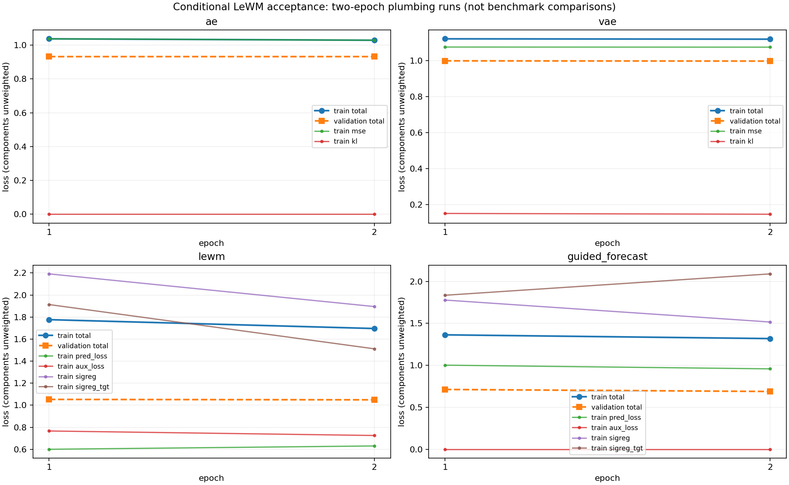

# Conditional LeWM independent acceptance

Status: **passed, 2026-11-10** — 29 assertion groups across four plain-Python scripts. The implementation and tests were owned by different agents. No source implementation was changed by the acceptance owner.

Environment: Python 3.12.3, PyTorch 2.12.0+cu132; CUDA device NVIDIA GeForce RTX 3060. Main experiments ran on CPU with one Torch thread. Module-level BF16 and a normal Trainer/GradScaler run also passed on CUDA.

## Reproduction and evidence

Run these commands from the repository root. Each script generates isolated fixtures/checkpoints under `/tmp`; the JSON files and captured logs beside this report are the authoritative recorded results.

```bash
./venv/bin/python tests/verify_conditional_models.py --output AGENTIC_DOCS/reports/lewm_conditional_acceptance/model_checks.json
./venv/bin/python tests/verify_conditional_runtime.py --output AGENTIC_DOCS/reports/lewm_conditional_acceptance/runtime_checks.json
./venv/bin/python tests/verify_conditional_transfer.py --output AGENTIC_DOCS/reports/lewm_conditional_acceptance/transfer_checks.json
./venv/bin/python tests/verify_conditional_suites.py --output AGENTIC_DOCS/reports/lewm_conditional_acceptance/suite_checks.json
```

| Script | Groups passed | Elapsed | Evidence |
| --- | ---: | ---: | --- |
| models | 12 | 3.22s | [model_checks.json](model_checks.json), [models.log](models.log) |
| runtime | 9 | 6.13s | [runtime_checks.json](runtime_checks.json), [runtime.log](runtime.log) |
| transfer | 3 | 6.13s | [transfer_checks.json](transfer_checks.json), [transfer.log](transfer.log) |
| suites | 5 | 15.93s | [suite_checks.json](suite_checks.json), [suites.log](suites.log) |

The first execution of the new model assertions was already green because concurrent implementation fixes had landed. The same first eight groups were then replayed against an isolated archive of baseline `22dc54c1a8ac573c198e2517c46ba8915d33c9c7`; all eight failed there. [initial_models.json](initial_models.json) records that regression evidence. This is archived-baseline verification, not a claim of strict red-first development.

## Architecture and numerical contracts

Shapes below are measured by assertions with raw sensor width 3 and latent width 6. One checkpoint accepts different legal temporal lengths; separate runs also passed with sensor widths 1 and 5. Real samples exercised 25 and 38 sensors.

| Experiment | Raw input | Current/history latent | Target/prediction latent | Output score |
| --- | --- | --- | --- | --- |
| AE / VAE | `[B,3,48]` | `[B,6,48]` | decoder `[B,3,48]` | `[B,48]` |
| Masked frequency LeWM | `[B,3,48]` | corrupted `[B,6,48]` | clean same-window `[B,6,48]` | `[B,48]` |
| Guided LeWM, stride 1 | `[B,3,48]` | history `[B,6,32]` | observed future / prediction `[B,6,16]` | `[B,16]`, raw interval `[32,48)` |
| Guided LeWM, source stride 2 | `[B,3,48]` | history `[B,6,16]` | future / prediction `[B,6,8]` | scalar latent scores interpolated to 16 raw positions |
| LeWM backbone + identity AE | `[B,3,48]` | source `[B,6,24]`, identity unchanged | decoder `[B,3,48]` | `[B,48]` |

Future-derived Q was observed to change only when future observations changed; paired historical K/V retained the historical token count. History/future lengths 32/16, 42/21, and 60/30 passed with one model. The guided predictor contains a length-preserving ConvTranspose1d; neither LeWM default has a raw reconstruction head. The frequency test checked actual packed complex coordinates and actual unpacked iSTFT output for multiple batch sizes and odd/even frame counts, plus unchanged STFT/iSTFT roundtrips.

KL/L1/MSE/L2 loss and score equations were checked against literal independent values. L2 is channel RMS, then mean over batch/time for loss; zero-error L2 gradients are finite and zero. Default latent KL and default L1 score remain independent: a shared channel offset gives zero KL but positive L1. Exact weighted summation, disabled operands, shape rejection, target-branch gradients, auxiliary BCE and unrestricted negative latents passed. Raw reconstruction was separately enabled and its decoder gradients verified.

## Short training, validation and test results

All four runs used two epochs, batch size 4, a 48-step window, stride 8, seed 17, and synthetic periodic/AR telemetry. Optimization used 123 clean rows; held-out validation used the remaining 53 rows. Test used a separate 112-row anomalous realization. All summaries and components are finite; actual checkpoints, resolved configs, TensorBoard files, architecture text, score arrays and per-aggregation exports are in the run directories linked by the JSON evidence.

| Run | Epoch-2 train loss | Epoch-2 validation loss | Best validation loss | Timestep calibrated F1 | Timestep oracle F1 | Covered test rows |
| --- | ---: | ---: | ---: | ---: | ---: | ---: |
| ae | 1.028895 | 0.932070 | 0.931963 | 0.676923 | 0.955556 | 112/112 |
| vae | 1.118207 | 0.996640 | 0.996640 | 0.676923 | 0.949721 | 112/112 |
| lewm | 1.695773 | 1.048729 | 1.048729 | 0.351852 | 0.929730 | 112/112 |
| guided_forecast | 1.318712 | 0.688705 | 0.688705 | 0.514286 | 0.967320 | 80/112 |

The table uses validation-selected weights for scoring; epoch-2 losses need not describe the best epoch. Window and non-overlap-window protocols are recorded separately in `runtime_checks.json`, with both calibrated and oracle results. The guided run correctly excludes its initial 32 context rows; raw reconstruction runs cover all 112 rows under overlapping evaluation. Non-overlap evaluation intentionally leaves incomplete final regions uncovered.



The two LeWM objectives were independently optimized on a fixed batch for 45 updates with fixed regularizer sketches:

| Model | Initial total | Final total | Guide-shuffle mean prediction change | History-shuffle mean prediction change |
| --- | ---: | ---: | ---: | ---: |
| lewm | 1.297186 | 0.510423 | 0.031716 | 0.362600 |
| guided_forecast | 1.075000 | 0.179424 | 0.080558 | 0.324008 |

Guide/history ablations demonstrate sensitivity of the trained computation, not a causal interpretation of the conditioning signal.

## Transfer and reproducibility

Five trained-source routes passed: AE→guided backbone, masked LeWM→guided backbone, LeWM→AE backbone plus identity, LeWM→trainable AE encoder (default), and LeWM→explicitly frozen AE encoder. All first transferred features matched the source exactly. Frozen parameters and BatchNorm buffers stayed unchanged while destination gradients flowed; trainable encoder parameters changed. Every route also ran the normal two-epoch training/validation/test entry. A guided destination then resumed through epoch 3 and scored while its original source checkpoint was unavailable.

Two actual baseline-source models were one-step trained in an archived baseline subprocess. Their saved constructor configs and legacy weights transferred without changing GELU/identity/stride behavior: maximum source-feature error was exactly zero for AE and LeWM. Those sources carried full-training normalization statistics, while the new destination retained optimization-row statistics; `normalization_changed: true` and both preprocessing descriptions were recorded. Equality is defined on the same normalized tensor input. Missing legacy schema is explicitly qualified by matched saved collection/series/width plus the destination reader order. Incompatible supplied schema/order, stride, activation and same-shaped forecast task semantics were rejected.

An uninterrupted three-epoch run and a one-epoch interruption followed by resume had bitwise-identical final weights and final component losses for both VAE and masked LeWM. The latter included an explicitly seeded SIGReg local generator. Repeated fixed-corruption validation and preflight left training RNG, model parameters and normalization buffers unchanged. A 4+4+1 batch fixture distinguished correct sample-weighted summaries from incorrect equal batch averaging.

## Dataset jobs and checkpoint protocol

The full PSM/SMD/TSB-U/TSB-M selection matrix passed, including PSM clearing inherited filenames, SMD file/all/all-one, and explicit TSB files or ordered file_name CSV lists with optional train_end and unrelated metadata. Missing/blank/duplicate selections failed preflight. TSB evaluation covered the 112-row suffix after the declared 160-row prefix; Label was excluded from features.

Pooled SMD trained one boundary-safe model, with per-machine normalization, thresholds, evaluation artifacts and macro metrics. Its oracle-F1 diagnostic checkpoint recorded a per-machine threshold scope instead of inventing a macro threshold. Separate source mappings selected each machine's best-validation checkpoint, falling back to best-training for a no-validation source.

Two concurrent worker processes had isolated output directories and fresh model/optimizer/RNG state. Removing one selected training file after preflight produced one recorded runtime failure while the other job completed; restoring it retried the failed job and skipped the completed one without touching its checkpoint. The same seeded job produced bitwise-identical weights sequentially and in the process pool. CLI training followed by --score executed scoring, an explicit distinct checkpoint changed scores, and missing output metrics were regenerated instead of being silently accepted as complete.

Primary best-validation (or best-training when validation is unavailable), rolling last, and ordinary-oracle-F1 checkpoints for all three aggregation strategies were separately verified. Clean thresholds were independently recomputed from the full clean training score distribution and its configured quantile. Exported cover counts were independently reconstructed from target intervals. Reloaded predictions/thresholds/scores were identical. A source with only one legal training span used every training row, no fabricated validation, and best-training selection; exactly two legal windows retained a disjoint train/validation pair even with requested validation fraction 0.1.

## Installed-data checks and limits

- PSM: actual reader, first/last training windows, model/loss and test score sample passed with 25 features; source `/home/manosbampis/Documents/EKETA/HyperAI/datasets/PSM`, file `psm`.
- SMD: actual reader, first/last training windows, model/loss and test score sample passed with 38 features; source `/home/manosbampis/Documents/EKETA/HyperAI/datasets/SMD`, file `machine-1-1.txt`.
- tsb-ad-u: real collection not installed; generated format/list fixtures passed.
- tsb-ad-m: real collection not installed; generated format/list fixtures passed.

These are plumbing and numerical checks, not benchmark-quality measurements. The tiny synthetic test has dense/overlapping anomaly segments and some window-level labels lack both classes; high oracle F1 must not be interpreted as detector quality. The format fixtures deliberately shift the clean validation distribution to expose scaler leakage, so their calibrated F1 can be zero. No full real-data training sweep, long-run stability evaluation, GPU out-of-memory failure injection, cross-device bitwise reproducibility, or physical/causal action validation was performed. All generated experiment outputs stayed under `/tmp`; the existing datasets symlink and pre-existing results directory were preserved.
